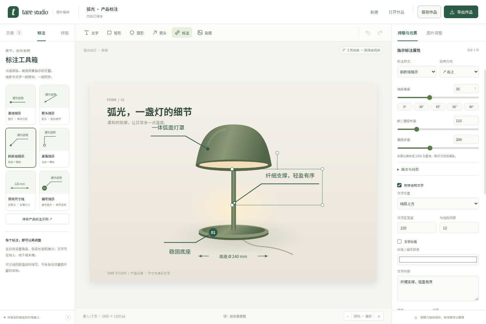

# Tare Studio

一个完全在本地运行的图片编排工具。导入图片，调色、裁剪，添加可编辑文字、模板标注、图形和贴图；让多张图共享整套排版，或只共享某一个元素，然后导出 PDF / PNG。



## 使用

Windows 用户打开发布包中的 `Tare Studio 2.1.0.exe`，无需安装 Node.js。第一次打开可点“体验示例作品”熟悉操作。

1. **导入图片**：支持多文件选择、拖入窗口、粘贴图片；支持 JPG、PNG、WebP、BMP。粘贴到已有页面时作为贴图添加。
2. **编辑**：画布上拖动、缩放、旋转；双击文字输入。右侧可设置字体大小、颜色、透明度、描边、对齐和图层顺序。长文字自动换行并增加文本框高度。
3. **图片调整**：曝光、亮度、对比度、饱和度、色温、锐化，以及原色、暖调、通透、黑白预设。裁剪比例、取景位置和 90° 旋转均可撤销。原始图片一直保留。
4. **整套共享**：左侧勾选目标页面，点击“让勾选页面共用当前排版”。目标页面采用当前排版，后续修改同步。此操作可撤销。
5. **单个元素共享**：选中某个标题、标注或贴图，点击“仅共享此元素到勾选页”。目标页其他排版保持不变。共享元素的内容、位置、样式和删除都会同步。
6. **独立编辑**：解除当前页共享可复制出独立排版；“让此元素在当前页独立”只解除该元素，其他共享元素继续同步。
7. **整理页面**：复选框多选、Shift 连选、全选；拖动已勾选的页面可整体排序，也可用前移、后移按钮。
8. **保存作品**：`.tare` 文件包含原图、所有调整、可编辑元素、共享关系和导出设置。自动恢复副本会保存在系统应用数据目录，关闭后再次打开会恢复最近工作。
9. **导出**：全部页面或仅勾选页面导出 PDF，支持中文封面、留白分隔页；也可导出当前页 PNG。透明区域按设置的底色合成。

PDF 和 PNG 是用于分享的画面文件；继续修改请保存 `.tare`。PDF 中的文字以高清画面输出，不是可搜索的文字层。多尺寸页面共享时，位置按页面宽高归一化，字号按页面宽度缩放。

## 标注工具箱

顶部或左侧点击“标注”，可选择六种模板：直线、箭头、斜折线、直角、双向尺寸线、编号指示。点选添加，也可把模板拖到图片上；松开的位置就是指示端。左侧“体验产品标注示例”可打开三款台灯配色，直接体验标注同步。

- **形状**：在右侧切换模板；独立调节角度、斜段 / 直段长度和横段长度。0°、30°、45°、60°、90° 有快捷按钮，延伸方向可选四个象限。
- **端点**：展开“端点与线型”，选择实心圆点、空心圆点、箭头、短横杠或编号。可改端点大小、编号文字，以及实线、虚线、点线。
- **文字**：勾选“附带说明文字”，选择在线上方、下方、末端或中间；可改文字区宽度、间距、衬底、字号、颜色及对齐。支持多行，双击标注也可直接编辑。
- **整体编辑**：线条与文字属于一个对象，拖动、复制、锁定和删除一起生效。角点缩放保持线段角度，以及文字、端点与线宽的比例；共享和解除共享与其他元素相同。
- **长度与尺寸**：长度、字号、线宽按画布宽度 1000 计算，换页或导出时自动缩放。斜段的两个方向均按宽度缩放，横竖页面之间共享不会改变折线角度。尺寸线上的数值需自行填写，不测量实物。

2.1 可以打开 2.0 的 `.tare` 作品。含新标注的作品需要 2.1 或更新版本；文字、参数、共享关系都随作品保存。

## 快捷键

| 操作 | 快捷键 |
| --- | --- |
| 保存 / 另存为 | Ctrl S / Ctrl Shift S |
| 撤销 / 重做 | Ctrl Z / Ctrl Shift Z（或 Ctrl Y） |
| 复制选中元素 | Ctrl D |
| 删除选中元素 | Delete / Backspace（输入框内只删除文字） |
| 微调位置 | 方向键；Shift 加速 |
| 完成画布文字输入 | Ctrl Enter |
| 平移画布 | 空格拖动 / 鼠标中键拖动 / 滚轮 |
| 缩放画布 | Ctrl 滚轮 / 底部加减按钮；点击百分比适应窗口 |

Mac 使用 Command 替代 Ctrl。

## 开发

需要 Node.js 22.16+ 和 npm。

```sh
npm ci
npm start
```

`npm start` 会先编译前端再启动 Electron；`npm run dev` 同时打开开发者工具。

```sh
npm test              # 文档、共享、标注几何、调色像素、裁剪的单元测试
npm run test:e2e      # 真实 Electron 窗口交互、文件保存与导出测试
npm run dist -- --win portable --x64
```

Linux 无显示器的云环境可运行：

```sh
TARE_E2E_NO_SANDBOX=1 xvfb-run -a -s '-screen 0 1600x1050x24' npm run test:e2e
```

`--no-sandbox` 仅用于不支持 Chromium 沙箱的隔离云容器。正常桌面启动保留沙箱。应用运行不依赖 CDN 或网络；安装及打包需要访问 npm 和 Electron 官方下载站。

## 结构

- `src/editor/model.mjs`：作品模型、稳定 ID、两种共享关系、历史、文件校验。
- `src/editor/canvas.mjs`：基于 Konva 的画布交互、对齐辅助线与共用导出绘制。
- `src/editor/annotations.mjs` / `annotation-canvas.mjs` / `annotation-controls.mjs`：标注参数与几何、统一绘制、模板与参数面板。
- `src/editor/filters.mjs` / `image.worker.mjs`：后台图片处理、边缘与透明度保护。
- `src/editor/app.mjs`：界面状态、批量操作、异步请求版本控制、自动保存。
- `src/editor/export.mjs`：PDF / PNG 导出。
- `src/desktop.cjs` / `preload.js`：限定用途的文件对话框与保存接口。
- `tests/`：单元与 Electron 集成测试。

用 Konva 替换原先不完整的手工 Canvas 操作实现；pdf-lib 和字体随应用打包。没有远程脚本、通用任意路径读写接口或 HTML 字符串插入用户输入。撤销记录共享不可变图片字符串，不为每次编辑复制原图。

旧版说明与修复历史在 `docs/legacy/`；旧设置不覆盖，1.x 的参数配置不自动迁移到 2.0 作品格式。

## 范围和限制

- 每个作品最多 300 页，每个排版最多 500 个元素；单张导入文件不超过 60 MB / 8000 万像素。作品文件最大 350 MB，超大项目建议分册保存。
- 预览最长边 1800 px；导出可选最长边 1600 / 2400 / 3600 px 或原始尺寸（最多 2400 万像素），小图不会放大。
- 撤销保留最近 60 步；自动恢复不替代独立作品文件和备份。
- 此版本为本地桌面编辑器，没有云端多人协同、AI 抠图或专业 CMYK 印刷功能。
- Windows 便携版未进行代码签名；平台实际测试范围见随发布提供的验证记录。

## 开源组件

Konva（MIT）、pdf-lib（MIT）、Electron（MIT）；Noto Sans SC（SIL OFL 1.1）。见 [第三方说明](THIRD_PARTY_NOTICES.md)。内置示例插画由本项目以 SVG 绘制，无需联网加载。
